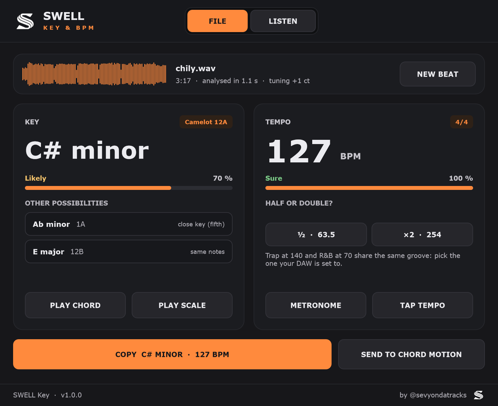
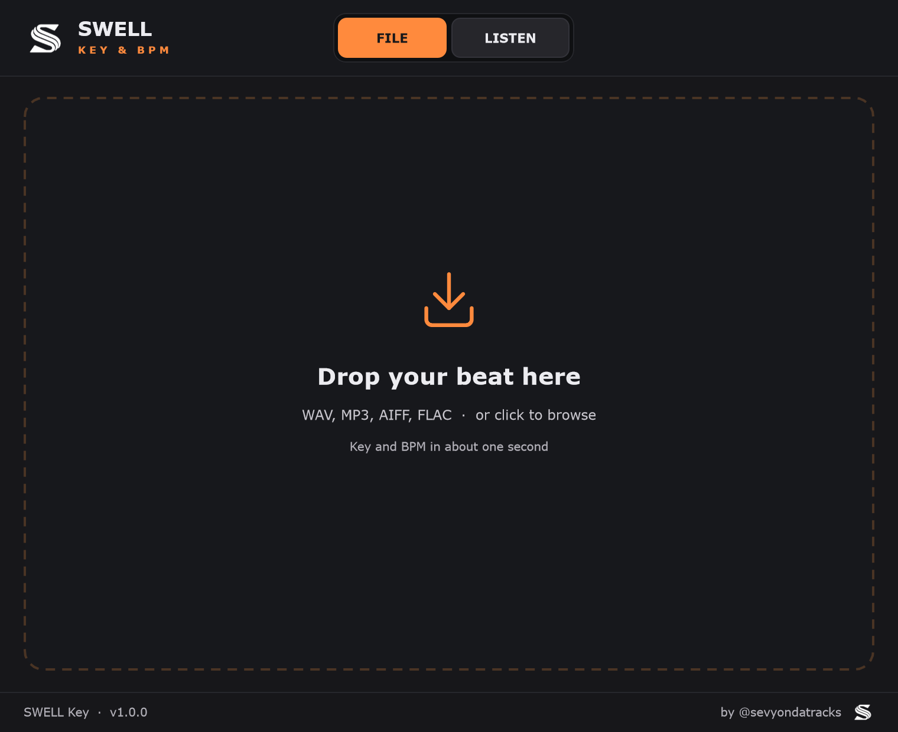
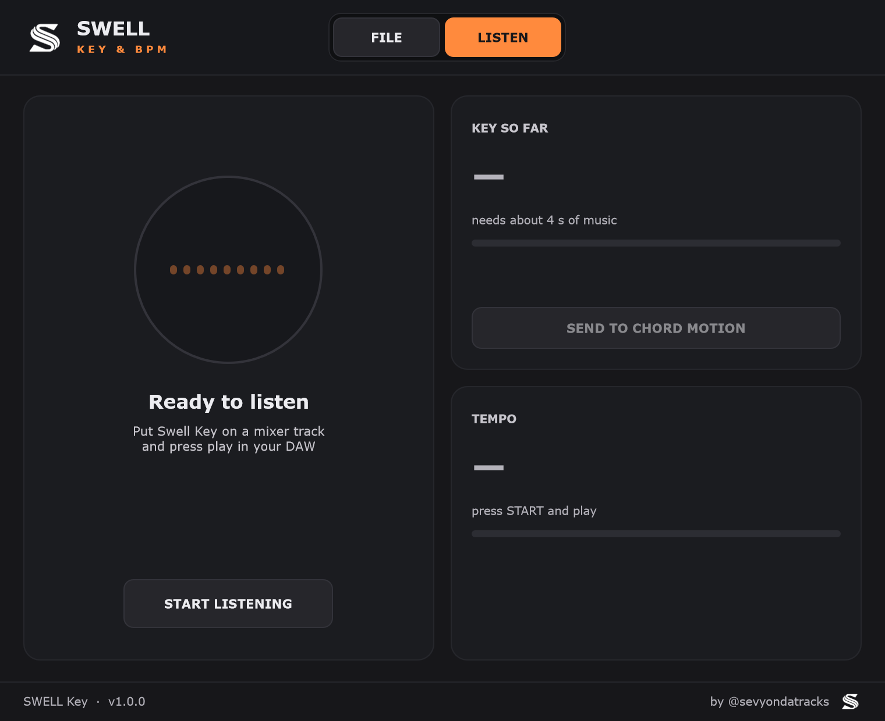

  

<h1 align="center">Swell Key</h1>

  La gamme et le BPM de n'importe quelle prod en une seconde — <b>Standalone</b>, <b>VST3</b> (Windows / Mac) et <b>AU</b> (Mac) 
  par <b>Swell-audio</b> · <a href="https://github.com/sevYOnDaTracks">@sevyondatracks</a>

---

## Utilisation

**FILE** : glisse une prod (WAV, MP3, AIFF, FLAC) sur le plugin, ou clique pour la choisir.
En une seconde environ, Swell Key affiche :

- **la gamme** (ex. *C# minor*), son code **Camelot** et une **confiance honnête** : *Sure*, *Likely* ou *Check by ear* ;
- **deux autres possibilités** (gamme voisine, mêmes notes…) : un clic pour choisir ;
- **le BPM**, avec les boutons **½** et **×2** (une trap à 140 et un R&B à 70 ont le même groove) ;
- **PLAY CHORD / PLAY SCALE** et **METRONOME** pour vérifier à l'oreille, **TAP TEMPO** pour taper le tempo ;
- **COPY** pour copier « C# minor · 127 BPM », **SEND TO CHORD MOTION** pour l'envoyer à Swell Chord Motion
  (bouton **SWELL KEY** dans Chord Motion v1.2+).

**LISTEN** : mets Swell Key sur une piste du mixer, clique **START LISTENING** et lance la lecture.
La gamme et le tempo se précisent au fil de l'écoute (environ 20 secondes).

| Fichier | Écoute |
|---|---|
|  |  |

## Fiabilité (mesurée)

Testé sur les jeux de test publics GiantSteps (1 265 morceaux, musique électronique, réponses vérifiées) :

| | |
|---|---|
| **BPM** juste (en comptant ½ et ×2) | **95 %** |
| **BPM** exact | 69 % |
| **Gamme** exacte | 58 % |
| **Bonne gamme** parmi les 3 propositions | 80 % |
| Confiance « Sure » (≥ 75 %) | juste **80 à 95 %** du temps |

Le pourcentage affiché est calibré : quand il dit 70 %, la gamme est juste environ 7 fois sur 10.

## Compiler

**Windows** (Visual Studio 2022 Build Tools + CMake) : `.\build.ps1`  
**Mac** (Xcode command line tools + CMake) : `./build-mac.sh`

`SwellKeyBench` (dans `tools/`) mesure le moteur : `synth` (beats générés), `dataset` (jeu annoté), `analyse` (fichiers).
